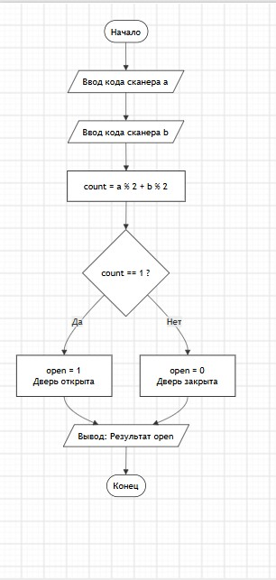

# Домашнее задание к 4 лабораторной

### 11 Вариант

### Доступ в коворкинг

#### В умном коворкинге два сканера: по лицу (A) и по карте (B). Система открывает дверь, если ровно один из сканеров вернул четный код доступа (такие коды выдаются временным посетителям). Запишите условие открытия двери.

```
#define _CRT_SECURE_NO_WARNINGS

#include <stdio.h>

#include <locale.h>

int main()

{
    
    setlocale(LC_CTYPE, "RUS");

    int a, b;
    
    printf("Введите код сканера a:");
    
    scanf("%d", &a);
    
    printf("Введите код сканера b:");
    
    scanf("%d", &b);
    
    int count = (a % 2) + (b % 2);
    
    int open = (count == 1);
    
    printf("Результат (1- открыть, 
    0-закрыть):%d\n", open);
    
    return 0;
}
```

### Вывод:
#### В лабораторной работе №4 были успешно закреплены практические навыки работы с базовыми типами данных языка С. В рамках задания спроектирована и написана программа,использующая целочисленные переменные для проверки условий четности кодов сканеров. Алгоритм работает корректно и полностью совпадает c представленной блок- схемой

